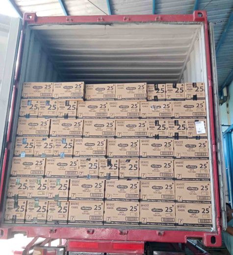
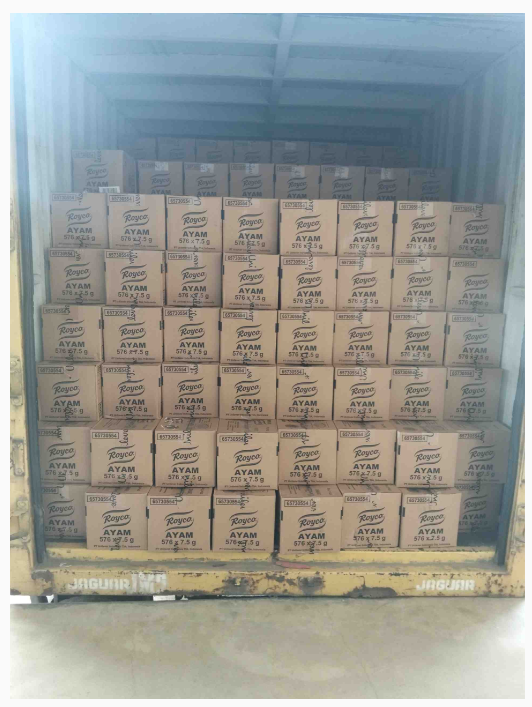
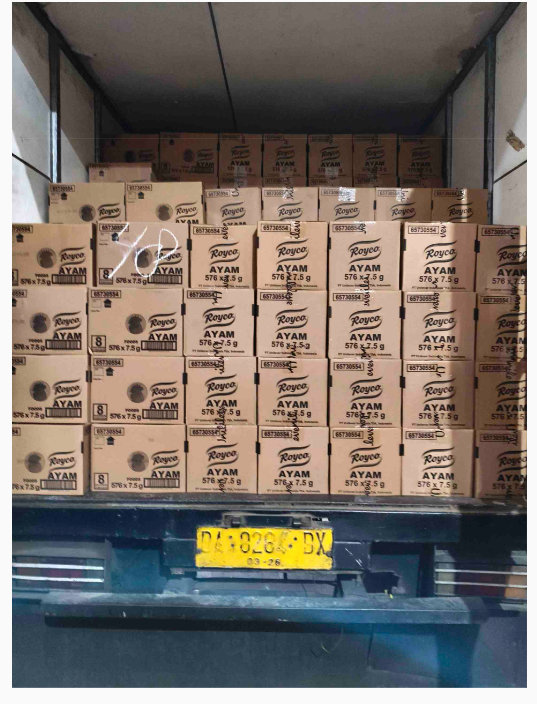
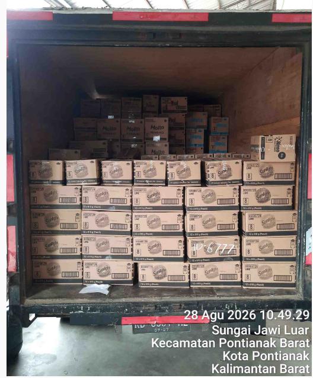
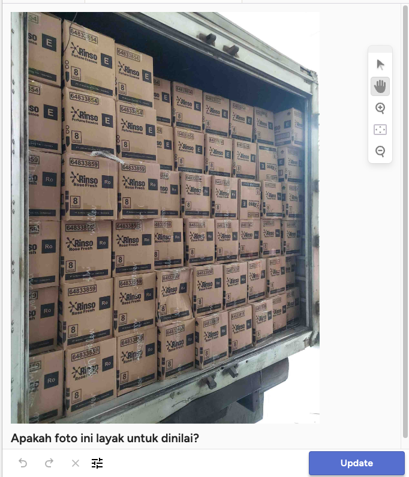

# Panduan Labeling: Foto Layak atau Tidak Layak (v3)

Terima kasih sudah membantu! Tugasnya sederhana: lihat satu foto muatan, lalu pilih **satu** jawaban.
Kira-kira **3–5 detik per foto**.

**Pertanyaan kunci:** _"Apakah seluruh bukaan pintu truk/kontainer terlihat, foto diambil lurus dari belakang,
dan label kardus bisa dibaca?"_ Kalau ya → **Layak**.

## Cara kerja

1. Buka link undangan, daftar dengan **email kantor masing-masing**, lalu login. **Jangan memakai akun admin
   bersama**: kami perlu tahu siapa melabel apa untuk mengecek konsistensi antar anggota tim.
2. Buka project yang diminta admin → klik **Label All Tasks**.
3. Lihat foto, tekan tombol angka, lalu **Ctrl + Enter** (Mac: **⌘ + Enter**) untuk Submit dan lanjut.

| Tombol | Pilihan | Kapan dipilih |
|---|---|---|
| **1** | **Layak** | Memenuhi **semua** syarat Layak di bawah |
| **2** | **Tidak layak - bukan foto muatan** | Foto tidak menunjukkan muatan di dalam truk/kontainer |
| **3** | **Tidak layak - foto muatan jelek** | Muatan ada, tetapi fotonya terpotong, miring, terhalang, blur, terlalu jauh, atau ada stamp |
| **4** | **Label tidak terbaca** | Foto utuh dan lurus, tetapi label kardus tertutup lakban/plastik |
| **5** | **Ragu** | Benar-benar tidak yakin. Lebih baik "Ragu" daripada menebak |

## Syarat Layak (semua harus terpenuhi)

| Syarat | Layak kalau… |
|---|---|
| **Utuh** | Rangka pintu terlihat: **dinding kiri, dinding kanan, dan atap/plafon** truk atau kontainer. Tidak ada kolom kardus yang terpotong tepi foto |
| **Lurus** | Difoto dari **belakang**, kamera kira-kira di tengah pintu. Bukaan pintu tampak hampir persegi panjang |
| **Tidak terhalang** | Tidak ada orang, barang, pintu, terpal, atau tangan di depan muatan |
| **Jelas** | Label kardus bisa dibaca (boleh dengan zoom). Tidak blur, tidak terlalu gelap/silau, tidak terlalu jauh |
| **Bersih** | Tidak ada stamp kamera (tanggal, jam, alamat dari GPS Map Camera / Timemark) dan bukan foto layar |

**Muatan karung:** truk berisi karung **tetap dinilai dengan syarat yang sama**. Kalau syaratnya terpenuhi → **Layak (1)**,
walaupun penyusunan karungnya terlihat salah. Pelanggaran penyusunan dinilai sistem, bukan saat labeling.

## Urutan memutuskan

1. Bukan foto muatan di dalam truk/kontainer? → **2**.
2. Muatan ada, tetapi salah satu syarat Utuh / Lurus / Tidak terhalang / Jelas / Bersih tidak terpenuhi? → **3**.
   Ini selalu menang atas "Label tidak terbaca".
3. Semua syarat terpenuhi, label bisa dibaca? → **1**.
4. Semua syarat terpenuhi kecuali label tertutup lakban/plastik? → **4**.
5. Masih bingung setelah ±10 detik? → **5**.

## Contoh resmi

| Foto | Jawaban | Alasan |
|---|---|---|
|  | **1 Layak** | Rangka kontainer terlihat di keempat sisi, lurus, label terbaca |
|  | **1 Layak** | Dinding kiri, kanan, dan atap terlihat, lurus, label terbaca |
|  | **3 Foto muatan jelek** | Kolom kardus paling kanan **terpotong** tepi foto |
|  | **3 Foto muatan jelek** | Ada **stamp kamera** (tanggal + alamat), walaupun muatannya bagus |
|  | **3 Foto muatan jelek** | Difoto **miring** dari sisi kiri |

## Contoh "Tidak layak - bukan foto muatan" (tombol 2)

- Dokumen / surat jalan / manifest / despatch note.
- Segel atau gembok pintu, pintu truk tertutup, plat nomor saja.
- Truk atau kontainer kosong, truk dari luar (kabin, samping badan truk), gudang, motor, halaman.
- Muatan tertutup terpal seluruhnya.
- Foto dari layar HP/monitor (ada pola garis-garis/moire).

## Contoh "Tidak layak - foto muatan jelek" (tombol 3)

- **Terpotong:** hanya sebagian muatan, rangka pintu kiri/kanan/atas tidak terlihat, atau foto close-up tumpukan.
- **Miring / dari samping / dari bawah**, termasuk foto samping truk wing box yang terbuka.
- **Terhalang** orang, barang, pintu, atau terpal.
- **Blur, gelap, silau**, atau **terlalu jauh** (kardus sangat kecil, sebagian besar foto berisi halaman).
- **Ada stamp kamera** (jam, tanggal, alamat).

## Contoh "Label tidak terbaca" (tombol 4)

- Foto utuh, lurus, dan jelas, **tetapi** label kardus tertutup lakban/plastik wrap, atau hanya sebagian kecil
  label yang terlihat.
- **Bukan** untuk foto blur, terpotong, ada stamp, atau dari samping: itu **3**.

## Tips

- Zoom: scroll mouse di atas foto. Cukup zoom kalau ragu soal label.
- Jangan terlalu lama di satu foto. Kalau lebih dari ±10 detik masih bingung, pilih **Ragu (5)**.
- Kalau ada foto aneh yang sering muncul, kabari admin supaya panduan ini bisa diperbarui.
